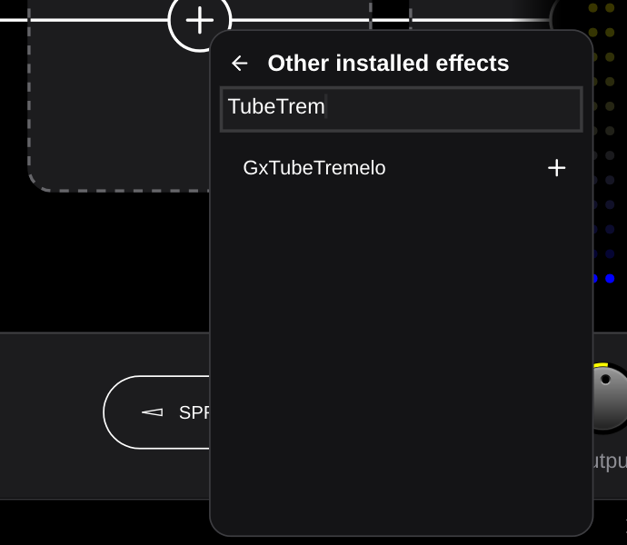

# TONE3000 FX for Raspberry Pi

Play through NAM captures, cabinet impulse responses, and LV2 effects in one signal chain. This community fork keeps the TONE3000 standalone interface and adds native ARM64 LV2 hosting for Raspberry Pi.

**Powered by TONE3000** for browsing and loading tones. [TONE3000](https://www.tone3000.com) - [Original project](https://github.com/tone-3000/tone3000-plugin)


## Install

**Target system:** Raspberry Pi 5 running 64-bit Raspberry Pi OS Trixie with a desktop session. You'll need an internet connection and a user account that can install packages with `sudo`.

On this repository's GitHub page, choose **Code - Download ZIP**, extract it on the Pi, and open a terminal in the extracted folder. Run:

```sh
bash install.sh
```

Run it as your regular desktop user. The installer uses `sudo` for missing system packages and builds the ARM64 standalone on your Pi. Choose **Yes** when it asks about Guitarix to get the effects used in the demo and their pedal artwork. The first build can take several minutes.

If you already have Git, you can use a clone instead.

```sh
git clone https://github.com/scullcom/tone3000-pi-fx.git
cd tone3000-pi-fx
bash install.sh
```

Open **TONE3000 FX** from the desktop application menu or run:

```sh
~/.local/bin/tone3000-pi-fx
```

The launcher uses a separate profile under `${XDG_CONFIG_HOME:-$HOME/.config}/tone3000-pi-fx`. To update, run the installer from a newer download or checkout. Your saved presets, favourites, custom images, and audio settings stay in that profile.

## Play your first rig

1. Connect your USB audio interface. Open **Audio Settings**, select your guitar input and monitoring output, and start with a buffer of 256 samples. Raise it if you hear dropouts.
2. Open **Clean Trem and Verb** from the presets menu. It contains **RiffSmith Clean ? GxTremolo ? GxReverb-Stereo** with the author's effect settings. RiffSmith Clean includes the cabinet, and its model is embedded so the demo can play offline. Install Guitarix when prompted to hear the tremolo and reverb.
3. Click an effect tile to adjust its controls. Use the power button to bypass it, the swap arrows to replace it in the same slot, or drag the tile to change the order.
4. Save your own copy and try it with another capture.

To browse the TONE3000 catalog, sign in from the app using your own account. The installer configures the upstream public OAuth client ID automatically. Local A2 `.nam` files and `.wav` cabinet IRs also load from the tile?s **Load File** action. [Upstream sign-in setup](https://github.com/tone-3000/tone3000-plugin#3-tone3000-publishable-key)

## Find and customise effects

Open **Add - LV2 Effect**. **Favourites** is your shortlist. Select **Other installed effects** and start typing to filter by name. Click an effect?s name to load it or **+** to favourite it. The bin button removes a favourite from the shortlist. The same picker opens from the swap arrows on an LV2 tile.



Guitarix artwork is matched by plug-in ID and cached on the Pi. In an LV2 block?s settings, **Choose image?** lets you import a PNG or JPEG for that effect. Blocks without artwork display their names. If a preset calls for a missing effect, the block shows which effect it needs and passes audio through until the plug-in is installed.

For unattended installs, pass `--with-guitarix` or `--without-guitarix` to `install.sh`. If an image download fails, rerun with `--with-guitarix` to retry. To report a problem, include your Pi model, Raspberry Pi OS release, audio interface, and the relevant installer output.

## Credits and licences

- The **TONE3000 team** created the original app, its native interface, and the catalog integration. [Upstream source and licence](https://github.com/tone-3000/tone3000-plugin)
- **Steven Atkinson and contributors** developed the DSP engine and audio libraries. [NeuralAmpModelerCore](https://github.com/sdatkinson/NeuralAmpModelerCore) ? [AudioDSPTools](https://github.com/sdatkinson/AudioDSPTools)
- **JUCE** provides the native audio and UI framework, including the Linux LV2 host. **LV2** is the open plug-in standard. [JUCE](https://github.com/juce-framework/JUCE) ? [LV2](https://lv2plug.in/)
- **Guitarix, GxPlugins, and MOD contributors** created the effects and pedal artwork. The installer downloads the images from their upstream sources. [Guitarix](https://github.com/brummer10/guitarix) ? [GxPlugins](https://github.com/brummer10/GxPlugins.lv2) ? [MOD](https://wiki.mod.audio/wiki/Preparing_the_Bundle) ? [Pinned artwork sources](script/guitarix-artwork-map.csv)
- **Matt Hartman** created RiffSmith Clean and released the capture under MIT. The demo embeds the original model bytes. [RiffSmith](https://github.com/hartmamt/riffsmith) ? [Capture notice](resources/factory-presets/Clean%20Trem%20and%20Verb.LICENSE.txt)
- **Lucide**, **Project Nayuki**, and the **Roboto Mono** and **Arimo** contributors supplied icons, QR generation, and fonts. [Lucide](https://lucide.dev/) ? [Nayuki QR Code generator](https://www.nayuki.io/page/qr-code-generator-library) ? [Font notices](plugin/ui/assets)

The source retains the upstream [MIT licence](LICENSE). Third-party components and assets retain their own licence terms. Access to the TONE3000 service is subject to its [API terms](https://www.tone3000.com/api/terms).
