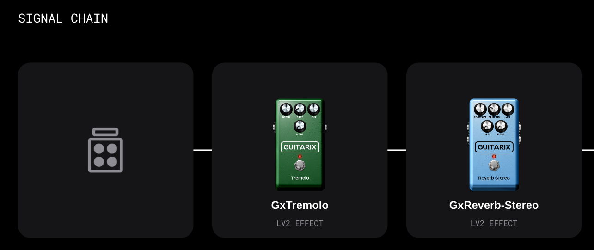

# TONE3000 FX for Raspberry Pi

TONE3000 FX is a community fork of the TONE3000 standalone app for Raspberry Pi 5. It adds native ARM64 LV2 effects alongside NAM captures and cabinet impulse responses, preset banks that reuse the same MIDI footswitches, and a Raspberry Pi installer with an offline demo rig.

**Powered by TONE3000** for browsing and loading tones. [TONE3000](https://www.tone3000.com) - [Original project](https://github.com/tone-3000/tone3000-plugin)

**Downloads** — [Latest release](https://github.com/scullcom/tone3000-pi-fx/releases/latest) · [All releases](https://github.com/scullcom/tone3000-pi-fx/releases) · [Changelog](CHANGELOG.md)



## What's new in v1.3.0

Back up your presets to a USB drive from the Settings and Login menu. **Export** lets you select whole banks or individual presets. **Import** merges banks by name and overwrites matching presets within the destination bank. [USB preset backup instructions](#usb-preset-backups)

## Quality-of-life features

- **Tune silently.** Turn on **Mute Audio in Tuner** under **Settings → System Settings**. The tuner still reads your guitar while the output is muted. Closing the tuner restores the output.
- **Manage effects from the block view.** Open an LV2 block to change its controls, choose custom artwork beside the plugin name, or use **Switch** and **Delete** on the right. Switching keeps the effect in the same slot.
- **Read Guitarix controls at a glance.** Graphic EQ and Bark Graphic EQ bands show their frequencies. Studio Preamp Stereo controls identify the left and right channels. Other verified Guitarix labels describe their controls more clearly, while existing presets retain their parameter values.
- **Power down from the kiosk.** In the separate Raspberry Pi kiosk image, open the Settings and Login menu and choose **Shut down Pi…**. The kiosk saves the working session for the next boot. [Kiosk image and setup](https://github.com/scullcom/tone3000-pi-fx-image)

Gx Tape Stereo is unavailable on ARM because it can crash the host. Use **GxTape** for the mono version. The picker also omits GxTuner and GxDetune. If an existing rig uses an unavailable effect, the block keeps its saved settings and passes audio through.

## Install

**Target system:** Raspberry Pi 5 running 64-bit Raspberry Pi OS Trixie with a desktop session. You'll need an internet connection and a user account that can install packages with `sudo`.

Open **Releases**, choose the version you want, and download **Source code (zip)** under **Assets**. Extract it on the Pi and run the installer from the extracted folder.

```sh
bash install.sh
```

Run it as your regular desktop user. The installer uses `sudo` for missing system packages and builds the ARM64 standalone on your Pi. Choose **Yes** when it asks about Guitarix to get the effects used in the demo and their pedal artwork. The first build can take several minutes.

If you already have Git, you can clone a release tag directly.

```sh
git clone --branch v1.3.0 --recurse-submodules https://github.com/scullcom/tone3000-pi-fx.git
cd tone3000-pi-fx
bash install.sh
```

Open **TONE3000 FX** from the desktop application menu or run:

```sh
~/.local/bin/tone3000-pi-fx
```

The launcher uses a separate profile under `${XDG_CONFIG_HOME:-$HOME/.config}/tone3000-pi-fx`. To update, run the installer from a newer download or checkout. Your saved presets, favourites, custom images, and audio settings stay in that profile.

## Play your first rig

1. Connect your USB audio interface. Open **Audio Settings**, select your guitar input and monitoring output, and start with a buffer of 256 samples. Raise it if you hear dropouts.
2. Open **Clean Trem and Verb** from the presets menu. It contains **RiffSmith Clean, GxTremolo and GxReverb-Stereo** with the author's effect settings. RiffSmith Clean includes the cabinet, and its model is embedded so the demo can play offline. Install Guitarix when prompted to hear the tremolo and reverb.
3. Click an effect tile to adjust its controls. Use the power button to bypass it, the swap arrows to replace it in the same slot, or drag the tile to change the order.
4. Save your own copy and try it with another capture.

To browse the TONE3000 catalog, sign in from the app using your own account. The installer configures the upstream public OAuth client ID automatically. Local A2 `.nam` files and `.wav` cabinet IRs also load from the tile's **Load File** action. [Upstream sign-in setup](https://github.com/tone-3000/tone3000-plugin#3-tone3000-publishable-key)

## Find and customise effects

Open **Add - LV2 Effect**. **Favourites** is your shortlist. Select **Other installed effects** and start typing to filter by name. Click an effect's name to load it or **+** to favourite it. The bin button removes a favourite from the shortlist. The same picker opens from the swap arrows on an LV2 tile.


Guitarix artwork is matched by plug-in ID and cached on the Pi. In an LV2 block's settings, **Choose image…** lets you import a PNG or JPEG for that effect. Blocks without artwork display their names. If a preset calls for a missing effect, the block shows which effect it needs and passes audio through until the plug-in is installed.

For unattended installs, pass `--with-guitarix` or `--without-guitarix` to `install.sh`. If an image download fails, rerun with `--with-guitarix` to retry. To report a problem, include your Pi model, Raspberry Pi OS release, audio interface, and the relevant installer output.

## Preset banks

Preset banks were introduced in [v1.1.0](https://github.com/scullcom/tone3000-pi-fx/releases/tag/v1.1.0). Open the preset picker and choose **New Bank** to create a named bank. Select the bank and choose **Save New Preset** to save the current rig there. Use reorder mode to drag presets within or between banks. The copy button creates an independent preset.

MIDI Program Change slots start at **PC 0** in each bank and follow the preset order. Use the bank arrows in the picker or map **Next Bank** and **Previous Bank** to MIDI CC in **Settings → Plugin Settings → MIDI Mapping**. The current rig keeps playing when you change banks. The bank name appears red until you load one of its presets.

Use a bank's pencil to rename it. Confirming **Delete Bank** deletes the bank and the presets in it. To back up your banks, keep the entire **Presets** folder, including `banks.json`.

## USB preset backups

From **v1.3.0**, choose **Export** or **Import** in the Settings and Login menu. Insert a USB drive and tick individual user presets or a bank to select everything in it. The backup uses `/Tone3000-pi-fx/presets` on the USB drive. Exporting replaces the contents of that folder after the new backup has been written.

Import merges banks with the same name and replaces matching preset names within each destination bank. Name matching is case-insensitive. New banks and presets are added, and factory presets are excluded. Existing presets elsewhere stay in their own banks.

The desktop installer includes UDisks for mounting removable drives. A kiosk image needs to be rebuilt with v1.3.0, `udisks2`, and the [USB mount policy](resources/kiosk/49-tone3000-preset-usb.rules) installed under `/etc/polkit-1/rules.d/` as root. The rule permits the `tone-kiosk` account to mount removable USB filesystems.

## Credits and licences

- The **TONE3000 team** created the original app, its native interface, and the catalog integration. [Upstream source and licence](https://github.com/tone-3000/tone3000-plugin)
- **Steven Atkinson and contributors** developed the DSP engine and audio libraries. [NeuralAmpModelerCore](https://github.com/sdatkinson/NeuralAmpModelerCore) - [AudioDSPTools](https://github.com/sdatkinson/AudioDSPTools)
- **JUCE** provides the native audio and UI framework, including the Linux LV2 host. **LV2** is the open plug-in standard. [JUCE](https://github.com/juce-framework/JUCE) - [LV2](https://lv2plug.in/)
- **Guitarix, GxPlugins, and MOD contributors** created the effects and pedal artwork. The installer downloads the images from their upstream sources. [Guitarix](https://github.com/brummer10/guitarix) - [GxPlugins](https://github.com/brummer10/GxPlugins.lv2) - [MOD](https://wiki.mod.audio/wiki/Preparing_the_Bundle) - [Pinned artwork sources](script/guitarix-artwork-map.csv)
- **Matt Hartman** created RiffSmith Clean and released the capture under MIT. The demo embeds the original model bytes. [RiffSmith](https://github.com/hartmamt/riffsmith) - [Capture notice](resources/factory-presets/Clean%20Trem%20and%20Verb.LICENSE.txt)
- **Lucide**, **Project Nayuki**, and the **Roboto Mono** and **Arimo** contributors supplied icons, QR generation, and fonts. [Lucide](https://lucide.dev/) - [Nayuki QR Code generator](https://www.nayuki.io/page/qr-code-generator-library) - [Font notices](plugin/ui/assets)

The source retains the upstream [MIT licence](LICENSE). Third-party components and assets retain their own licence terms. Access to the TONE3000 service is subject to its [API terms](https://www.tone3000.com/api/terms).
